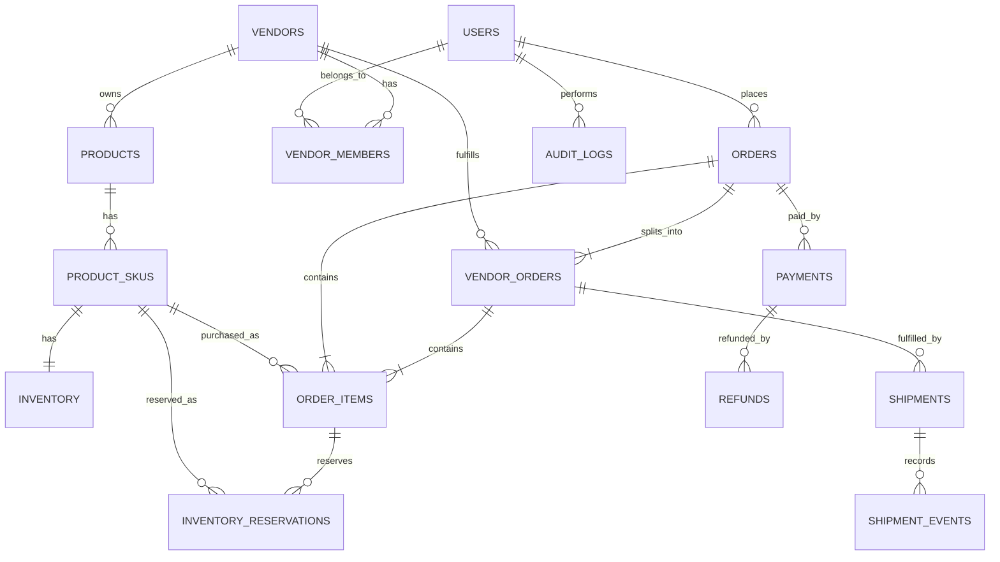

# Multi-Vendor Commerce Platform — MVP ERD

## Overview

The platform supports a multi-vendor marketplace.

A customer places one parent order, but the order may contain products from multiple vendors.

The system therefore separates:

- Customer Order → the complete checkout
- Vendor Order → one vendor's responsibility inside the order
- Order Item → the individual purchased SKU

Example:

Customer Order #1001

- Vendor Order A
  - Shirt × 2
  - Pants × 1

- Vendor Order B
  - Shoes × 1

This allows vendors to fulfill, cancel, ship, or refund their portions independently.

---

## ERD

---

# Entities

## users

Represents people who can access the platform.

Important fields:

- id
- email
- password_hash
- role
- created_at
- updated_at

Possible roles:

- CUSTOMER
- VENDOR_STAFF
- ADMIN

---

## vendors

Represents a seller/business operating in the marketplace.

Important fields:

- id
- name
- status
- created_at
- updated_at

A vendor can own many products.

---

## vendor_members

Connects users to vendors.

Important fields:

- id
- vendor_id
- user_id
- role
- created_at

This allows multiple staff members to work for one vendor.

A user must not automatically gain access to another vendor's resources.

---

## products

Represents a product sold by a vendor.

Important fields:

- id
- vendor_id
- name
- description
- status
- created_at
- updated_at

A product belongs to exactly one vendor.

A product can have multiple SKUs.

---

## product_skus

Represents a purchasable variation of a product.

Example:

Product:

Nike T-Shirt

SKUs:

- Black / M
- Black / L
- White / M

Important fields:

- id
- product_id
- sku_code
- price
- status
- created_at
- updated_at

sku_code must be unique.

price must never be negative.

---

## inventory

Stores current inventory information for a SKU.

Important fields:

- id
- sku_id
- quantity_on_hand
- created_at
- updated_at

quantity_on_hand must never be negative.

---

## inventory_reservations

Represents stock temporarily reserved for an order item.

Important fields:

- id
- sku_id
- order_item_id
- quantity
- status
- expires_at
- created_at

Possible statuses:

- ACTIVE
- RELEASED
- CONSUMED
- EXPIRED

Reservation quantity must be greater than zero.

Reservations help prevent two customers from purchasing the same final unit.

---

## orders

The parent/customer-facing order.

Important fields:

- id
- order_number
- customer_id
- status
- subtotal
- total_amount
- created_at
- updated_at

Example:

One checkout:

- Vendor A → Shirt
- Vendor B → Shoes

The customer still receives one parent order.

order_number must be unique.

Amounts must never be negative.

---

## vendor_orders

Represents one vendor's portion of a parent order.

Important fields:

- id
- order_id
- vendor_id
- status
- subtotal
- created_at
- updated_at

Example:

Order #1001

becomes:

Vendor Order #1 → Vendor A

Vendor Order #2 → Vendor B

Each vendor can process its portion independently.

---

## order_items

Represents purchased SKU snapshots.

Important fields:

- id
- order_id
- vendor_order_id
- sku_id
- product_name
- sku_code
- unit_price
- quantity
- line_total
- created_at

Important:

Order items store purchase-time values such as product name,
SKU code and price.

Historical orders must not change when the product catalog changes later.

quantity must be greater than zero.

unit_price and line_total must never be negative.

---

## payments

Represents payment attempts/transactions.

Important fields:

- id
- order_id
- provider
- external_transaction_id
- method
- status
- amount
- created_at
- updated_at

Possible methods:

- COD
- ONLINE

Possible statuses:

- PENDING
- AUTHORIZED
- PAID
- FAILED
- CANCELLED

external_transaction_id must be unique when present.

This helps make payment callbacks idempotent.

---

## refunds

Represents money returned from a payment.

Important fields:

- id
- payment_id
- external_refund_id
- amount
- status
- reason
- created_at

Refund amount must be greater than zero.

external_refund_id must be unique when present.

---

## shipments

Represents fulfillment/shipping for a vendor order.

Important fields:

- id
- vendor_order_id
- tracking_number
- carrier
- status
- created_at
- updated_at

A vendor order may have multiple shipment records if partial fulfillment is required.

---

## shipment_events

Stores shipment history.

Important fields:

- id
- shipment_id
- status
- description
- occurred_at
- created_at

Example:

CREATED
↓
PACKED
↓
SHIPPED
↓
IN_TRANSIT
↓
DELIVERED

Shipment history should be appended instead of overwritten.

---

## audit_logs

Records important actions.

Important fields:

- id
- actor_user_id
- action
- entity_type
- entity_id
- metadata
- created_at

Examples:

- vendor changed inventory
- admin approved refund
- order cancelled
- payment status changed

Audit records should be append-only.

---

# Parent Order vs Vendor Order

The most important relationship in the commerce model is:

Customer

↓

Order

↓

Vendor Orders

↓

Order Items

Example:

Order #1001
Total = 5000

Vendor A Order
Subtotal = 3000

- Shirt = 1000
- Pants = 2000

Vendor B Order
Subtotal = 2000

- Shoes = 2000

Vendor A can ship its products without waiting for Vendor B.

Therefore:

Vendor A → DELIVERED

Vendor B → PROCESSING

can both exist at the same time.

The parent order status should be derived from or coordinated with
the states of its vendor orders rather than destroying their individual history.
